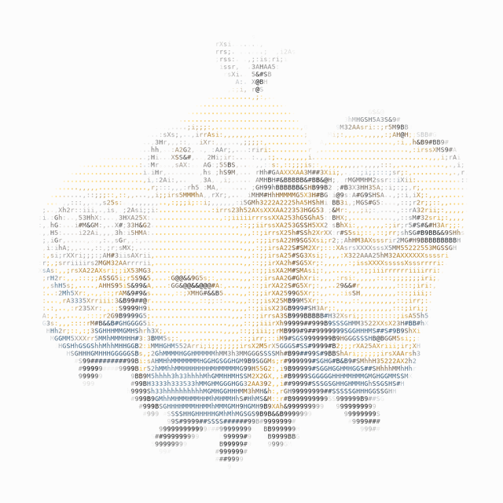
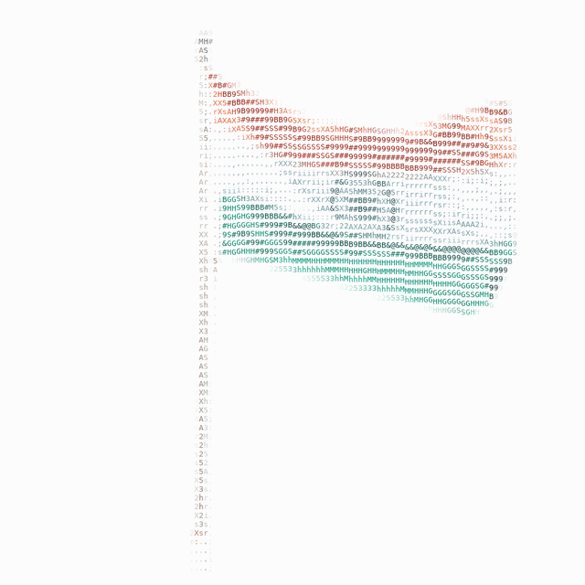

# ASCII Profile Generator

This turns a photo into ASCII art you can put on your GitHub profile. You pick an image, answer a few questions about how it should look, and the tool saves the result as an SVG, PNG, JPEG, or GIF.

If you want animation, it can do that too. Fifteen animation styles are shown further down, all made from the same photo.

## Sample

The project comes with `sample.png`, the photo used for every example in this README.


The whole idea in one line:

**Pick an image → generate ASCII artwork → save it → put it on your GitHub profile.**

## From photo to GitHub profile

Here is the full journey before you start, so you know where this is going:

```text
Your photo
    ↓
Download this repository
    ↓
Run setup
    ↓
Choose your image
    ↓
Generate ASCII artwork
    ↓
Choose PNG / SVG / GIF
    ↓
Upload the result to your GitHub profile repository
    ↓
Add it to README.md
    ↓
Done
```

A concrete version of the same thing:

```text
my-photo.jpg
        ↓
ASCII Profile Generator
        ↓
avi-ascii.gif
        ↓
username/username
        ↓
README.md
        ↓
GitHub profile
```

## Before you start

You need three things:

- Python 3
- an image you want to convert
- a computer running macOS, Windows, or Linux

You do not need Git, GitHub accounts set up for cloning, or any extra libraries installed by hand. The project sets up its own dependency later.

Check that Python 3 is there.

On macOS or Linux:

```bash
python3 --version
```

On Windows:

```powershell
py --version
```

If you get a version number back, you are ready. If the command is not found, install Python from https://www.python.org/downloads/ and run the check again.

## Download the project

If you just want to use the generator, this is the easiest way. You do not need Git for it.

1. Open the repository on GitHub.
2. Click the green **Code** button.
3. Click **Download ZIP**.
4. Extract the ZIP somewhere you can find again, like your Desktop.
5. Open the extracted `ascii-profile-generator` folder.

When you click **Code**, you will also see HTTPS, SSH, and GitHub CLI. Those are ways to copy the repository using Git. If you are just getting started, Download ZIP is the simplest option and skips all of that. (If you already use Git and prefer it, GitHub Desktop is a friendly way to clone, but you do not need it here.)

## Set up the project

Setup is one command. It creates a private Python environment inside the project folder (a `.venv` folder) and installs the one library the generator needs. You do not install anything by hand.

Run these from inside the `ascii-profile-generator` folder.

### macOS

```bash
python3 setup.py
```

### Linux

```bash
python3 setup.py
```

### Windows

```powershell
py setup.py
```

That is the whole setup. You only do it once.

## Add your image

Put the image you want to convert inside the project folder, next to the other files:

```text
ascii-profile-generator/
├── ascii_generator.py
├── ascii_renderer.py
├── exporter.py
├── animations.py
├── setup.py
├── requirements.txt
├── sample.png
└── my-photo.jpg
```

`my-photo.jpg` is just an example name. Use whatever your file is actually called.

## Generate your ASCII artwork

Run the generator with your image. Use the Python that setup created inside the project, not your system Python. The path is slightly different on Windows.

### macOS / Linux

```bash
.venv/bin/python ascii_generator.py my-photo.jpg
```

### Windows

```powershell
.venv\Scripts\python.exe ascii_generator.py my-photo.jpg
```

Windows keeps the environment's Python under `.venv\Scripts` instead of `.venv/bin`, which is why the path differs. Running this project Python directly is simpler than activating the environment, so that is what these instructions use.

Once it starts, the generator asks you how you want the artwork to look. You choose:

- the look and theme
- the colors
- the size
- image adjustments like contrast and brightness
- an animation, if you want one
- the output format

At the end it saves the result in the project folder. The file is named `avi-ascii` with the extension for the format you picked, for example `avi-ascii.gif`.

### Which format should I pick?

- **SVG** is good for scalable web artwork that stays sharp at any size.
- **PNG** is good for a normal static image.
- **JPEG** is useful when you do not need a transparent background.
- **GIF** is the one to pick when you want animation.

## Use it on your GitHub profile

"GitHub profile image" can mean two different things, and they work differently. Pick the one you want.

### A. Large artwork on your profile page

This is the big image that shows up at the top of your profile, inside your **profile README**. It is the best fit for animated ASCII art.

1. Generate the artwork.
2. Pick GIF if you want it animated.
3. Open your GitHub profile repository. This is a special repository named the same as your username.

   For a user named `octocat`, it is:

   ```text
   octocat/octocat
   ```

   So in general it looks like `username/username`. If you do not have one yet, GitHub lets you create a new repository with your own username as the name, and it will offer to use it for your profile.
4. Open that repository.
5. Click **Add file → Upload files**.
6. Upload the file you generated (the GIF, PNG, or SVG).
7. Commit the change (the button to save it).
8. Open `README.md` in that repository.
9. Add the image to the README. A simple way:

   ```html
   <p align="center">
     
   </p>
   ```

   Replace `my-ascii.gif` with the exact filename you uploaded.
10. Commit the README change.

Open your GitHub profile. The artwork should now appear in your profile README.

GitHub's own guide to profile READMEs is here: https://docs.github.com/en/account-and-profile/setting-up-and-managing-your-github-profile/customizing-your-profile/managing-your-profile-readme

### B. Want it as your profile picture instead?

The profile README and the small round profile picture (the avatar) are not the same thing. The avatar is the little circular image next to your name.

For the avatar:

1. Generate a PNG or JPEG.
2. Open GitHub.
3. Go to **Settings → Public profile**.
4. Under profile picture, upload the image you generated.
5. Crop it and save.

Use a PNG or JPEG for the avatar. GitHub shows the avatar as a still image, so a GIF will not animate there.

## Animation showcase

Every GIF below is made from the same `sample.png`, so you can compare the styles side by side. You can make your own version of any of these from your own photo.

### Reveal

| Row Reveal | Column Reveal | Diagonal Reveal | Iris Aperture | Circular Reveal |
| --- | --- | --- | --- | --- |
|  |  |  |  |  |

- Row Reveal · Builds the image from top to bottom.
- Column Reveal · Builds it from left to right.
- Diagonal Reveal · Uncovers across a diagonal.
- Iris Aperture · Opens an eight-sided aperture.
- Circular Reveal · Expands a circular opening.

### Effects

| Fade In | Twinkle | Sparkle Wave | Typewriter | Dissolve |
| --- | --- | --- | --- | --- |
|  |  |  |  |  |

- Fade In · Fades the whole image into view.
- Twinkle · Adds subtle animated highlights.
- Sparkle Wave · Moves a soft shimmer across the glyphs.
- Typewriter · Types the image out line by line.
- Dissolve · Assembles the image from scattered groups.

### Dynamic

| Digital Rain | Tetris | Mosaic |
| --- | --- | --- |
|  |  |  |

- Digital Rain · Adds falling streams around the artwork.
- Tetris · Reconstructs the image with falling blocks.
- Mosaic · Opens tiles that uncover the artwork.

### Static & Special

| Instant | Flag Wave |
| --- | --- |
|  |  |

- Instant · Shows the complete artwork with no animation.
- Flag Wave · Gives the artwork a waving flag effect.

## Features

- Customizable ASCII character ramp (density)
- Image size and cell size controls
- Brightness, contrast, and gamma adjustments
- Color modes and custom palettes
- Export to SVG, PNG, JPEG, or GIF
- 15 animation styles
- A GitHub Profile preset

### Color modes

When the generator asks about color, you can:

- **Original** · keep the source colors
- **Light** · white background, black characters
- **Dark** · black background, white characters
- **Custom** · choose your own foreground and background
- **Multicolour** · supply a palette

With Original, you can keep the background transparent (SVG and PNG) or fill it with a color. JPEG and GIF always use a solid background.

## GitHub Profile preset

If your goal is a GitHub profile README, choose **GitHub Profile** when the generator asks. At the color menu, pick **Additional**, then **GitHub Profile Preset**. It starts you with settings that work well for profile artwork: Original colors on a transparent background, a looping Twinkle animation, a 100 × 50 grid, and SVG output.

These are just starting points. At the confirmation prompt, type `edit` to change anything before you generate the final image.

## Troubleshooting

### "python3: command not found"

Python is not installed, or it is not on your PATH. Install it from https://www.python.org/downloads/.

### "py is not recognized" on Windows

Python is not installed correctly, or the Python launcher is missing. Reinstall Python and make sure the launcher option stays checked.

### "No such file or directory"

You are probably not inside the `ascii-profile-generator` folder. Open that folder first, then run the command.

### My image isn't found

Make sure the image is inside the project folder, or give the correct path to it when you run the generator.

### My GitHub image isn't showing

Check that:

- the image was uploaded to your profile repository
- the filename in `README.md` matches the uploaded filename exactly
- you committed the README change
- the image path is correct

## Project structure

```text
ascii-profile-generator/
├── ascii_generator.py
├── ascii_renderer.py
├── exporter.py
├── animations.py
├── setup.py
├── requirements.txt
├── sample.png
├── examples/
│   └── animations/
└── tests/
```

Run the tests with `.venv/bin/python -m unittest discover` (`.venv\Scripts\python.exe -m unittest discover` on Windows).

## License

Released under the [MIT License](LICENSE).
